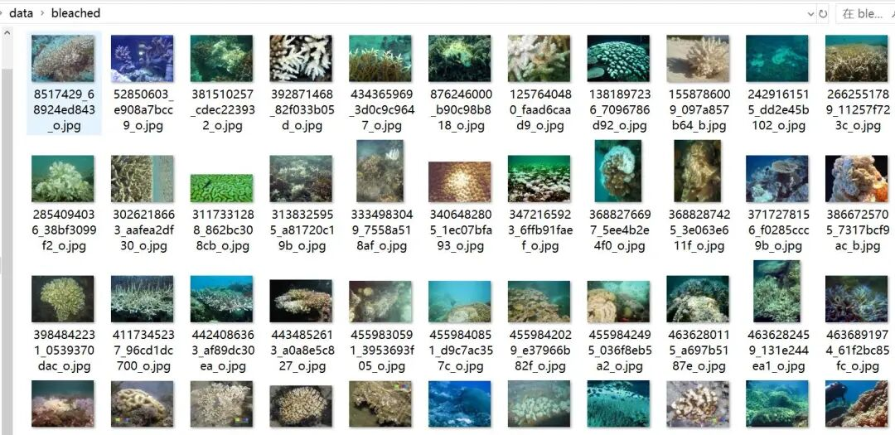
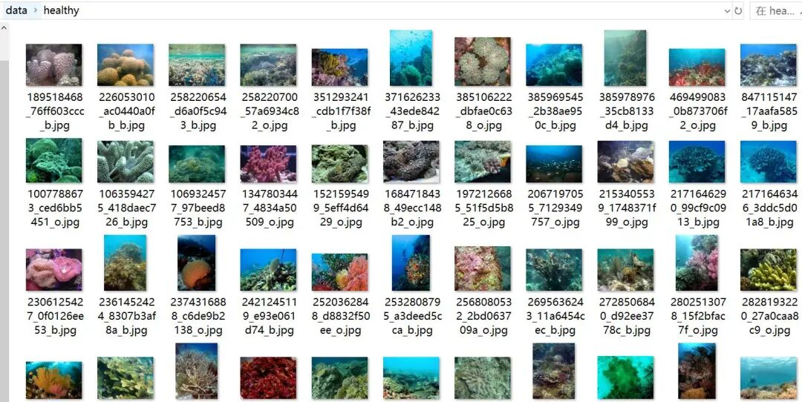

# Coral bleaching classification dataset 923 images in 2 categories

Dataset type: Image classification, not for object detection without annotations.

Dataset format: Only contains jpg images, each category folder contains the corresponding image.

Number of images (number of jpg files): 923

Category: 2

Category Name: ["bleached", "healthy"]

Number of images per category:

Bleached image count: 485

Healthy image count: 438

Important Notice: No

Special : This dataset does not guarantee the accuracy of the trained models or weight files. The dataset is provided for accurate and reasonable classification storage only.

Image Preview:

## Payment

Here is a pay link on Stripe ( https://buy.stripe.com/3cs8yP7sY87d0vu9AB ). Please contact me lonlonago@foxmail.com after funding $89, and I will send you a complete data files , thank you!

